<div align="center">

# 🩺 Personal Health Copilot

### Intelligent Family Health Passbook & Clinical Intelligence Engine

[](https://mycopilot.qd.je)
[](https://mycopilot.qd.je)
[](https://nrces.in)

[](https://nextjs.org)
[](https://fastapi.tiangolo.com)
[](https://deepmind.google/technologies/gemini/)
[](https://groq.com)
[](https://supabase.com)

---

**Transforms unstructured Indian paper prescriptions, handwritten doctor notes, complex lab reports, and hospital discharge summaries into structured, verified, trilingual health intelligence — mapped to India's ABDM FHIR R4 standards.**

**English** · **हिन्दी** · **తెలుగు**

</div>

---

## 📸 Application Showcase

Screenshots of the current build with the sample family (Load sample).

<table>
<tr>
<td width="50%">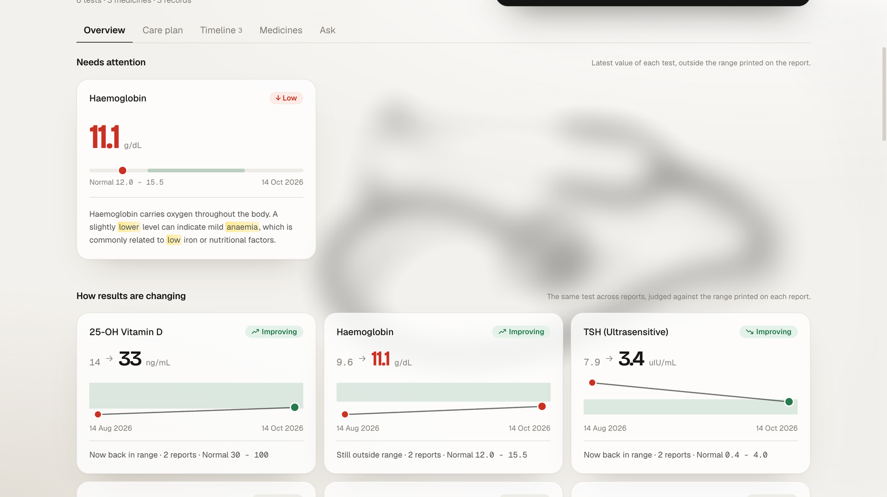<br/><b>Problems first, then trends</b> — Low values against the printed range, and how each test is changing across reports</td>
<td width="50%">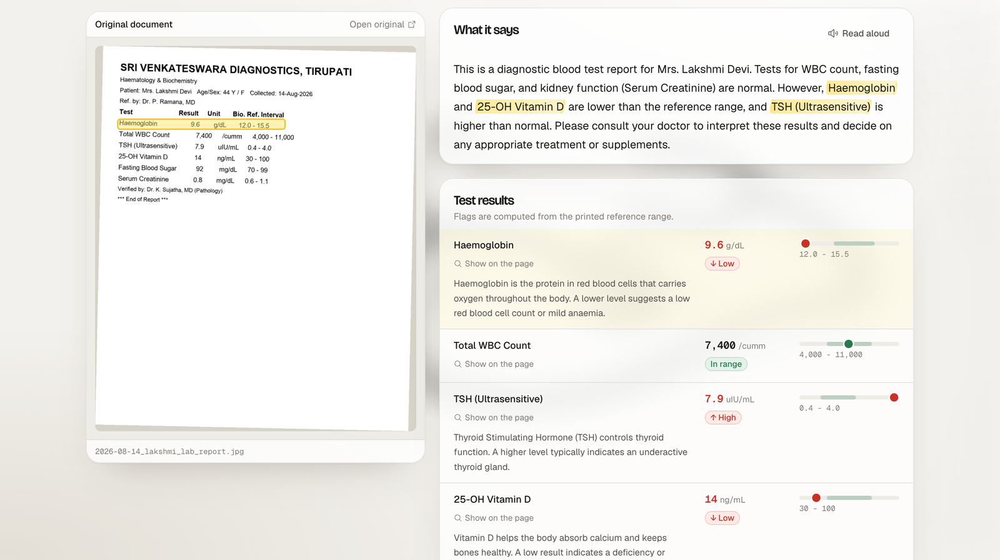<br/><b>Every number is checkable</b> — Hover a value and it lights up where it is printed on the original page</td>
</tr>
<tr>
<td width="50%">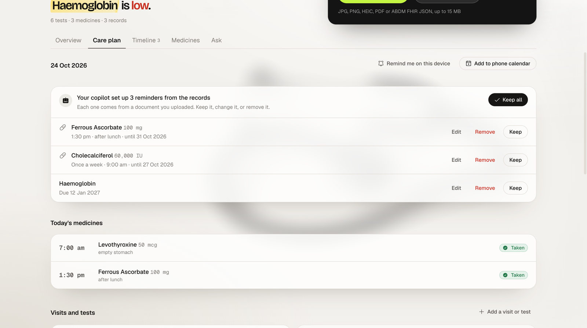<br/><b>Care-plan agent</b> — Reminders set up from the prescription; the family keeps, edits or removes each one</td>
<td width="50%">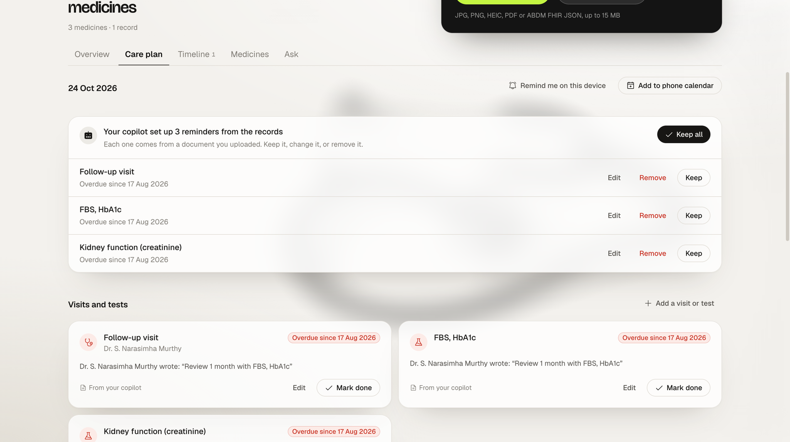<br/><b>Overdue visits and tests</b> — Quotes the doctor's own words and drafts questions for the next visit</td>
</tr>
<tr>
<td width="50%">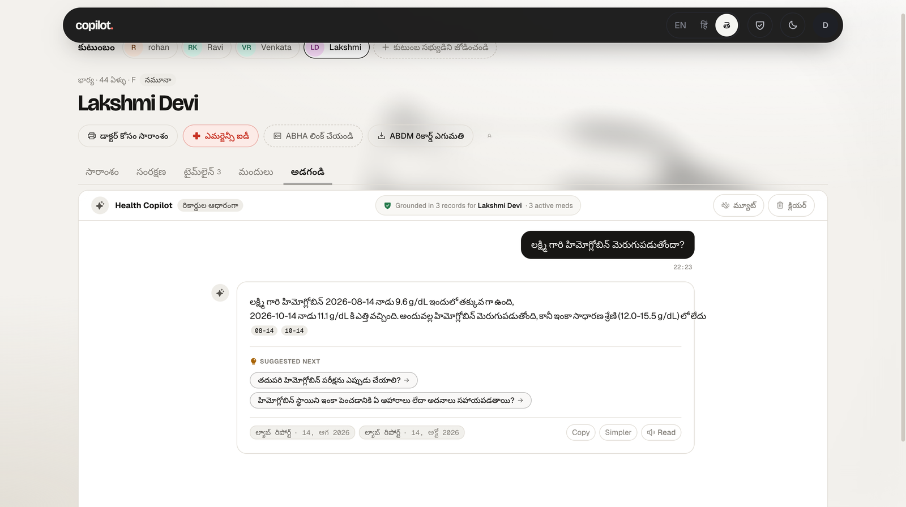<br/><b>Answers in Telugu, Hindi or English</b> — Grounded in the person's records, with the source reports cited</td>
<td width="50%">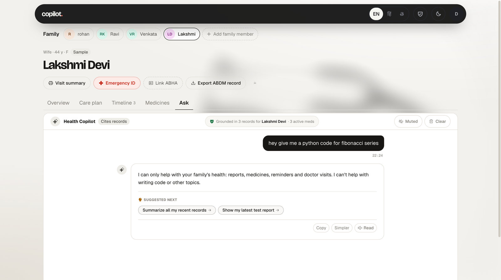<br/><b>Health questions only</b> — Requests for code or other topics are declined before any model runs</td>
</tr>
<tr>
<td width="50%">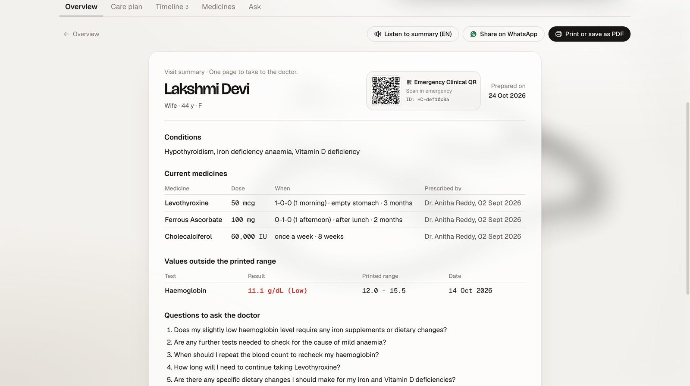<br/><b>Doctor Visit Summary</b> — One page to take to the doctor, with an emergency QR</td>
<td width="50%">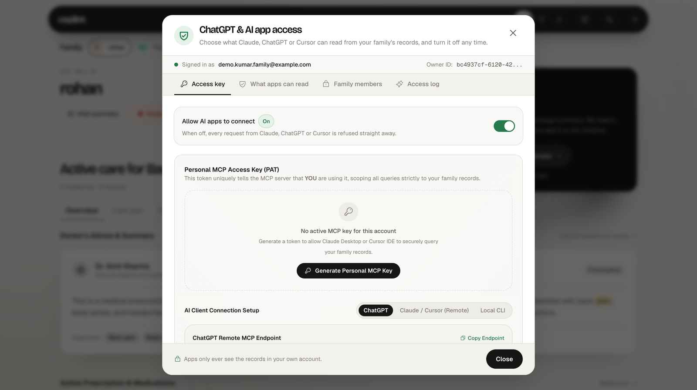<br/><b>ChatGPT, Claude & Cursor access (MCP)</b> — Personal key per family, kill switch, per-tool and per-person controls, access log</td>
</tr>
<tr>
<td width="50%">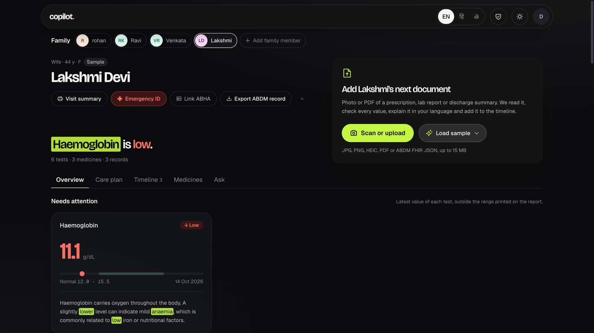<br/><b>Dark Mode</b> — High contrast, elder-friendly design</td>
<td width="50%">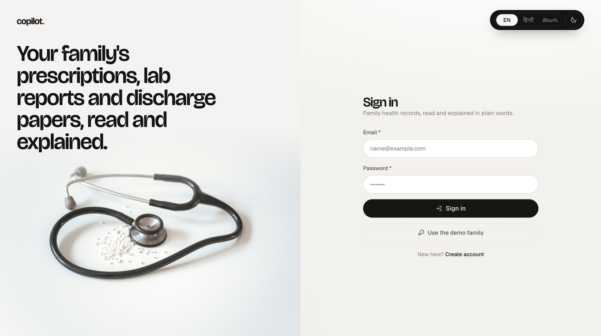<br/><b>Sign in</b> — Own account, or the demo family in one click</td>
</tr>
</table>

---

## 📑 Table of Contents

| Section | Description |
|---|---|
| [The Problem We Solve](#-the-problem-we-solve) | Why this matters for 300M+ Indian families |
| [System Architecture](#-system-architecture) | End-to-end technical design |
| [Deployment Architecture](#-deployment-architecture) | Cloud infrastructure topology |
| [AI Intelligence Layer](#-ai-intelligence-layer) | Multi-agent pipeline & model routing |
| [Core Features](#-core-features) | What sets Health Copilot apart |
| [Data Model & Security](#-data-model--security) | PostgreSQL RLS & patient isolation |
| [Local Setup](#-local-setup) | Get running in 5 minutes |
| [Live Demo Script](#-live-demo-script) | 5-minute walkthrough for judges |
| [Clinical Safety](#-clinical-safety) | Six layers of medical guardrails |
| [Architecture & Features](#-clinical-architecture--feature-capabilities) | Point-by-point clinical architecture mapping |

---

## 🌍 The Problem We Solve

### The Caregiver Reality in India

In Indian households, health management is **multigenerational and caregiver-driven**. An adult son or daughter typically manages paper health records for elderly parents, children, and themselves — often across multiple languages and doctors.

```mermaid
flowchart LR
    subgraph Before["❌ Chaotic Reality"]
        direction TB
        P1["📄 Crinkled paper prescriptions"]
        P2["✍️ Unreadable doctor handwriting"]
        P3["📊 Complex multi-row lab reports"]
        P4["💊 Shorthand notation (1-0-1, OD, BD)"]
        P5["📋 Faded discharge summaries"]
        P6["😰 Panic over medical terms"]
    end

    subgraph After["✅ Health Copilot"]
        direction TB
        S1["📱 One unified digital Family Passbook"]
        S2["🔍 High-accuracy Multimodal Vision OCR"]
        S3["📐 Deterministic Reference Range Check"]
        S4["🌐 Trilingual Parity — EN / HI / TE"]
        S5["📎 Grounded Copilot with Source Citations"]
        S6["🏥 NRCES-compliant ABDM FHIR R4 Export"]
    end

    Before -- "AI Engine" --> After
```

### Three Critical Clinical Bottlenecks We Address

| Bottleneck | The Danger | Our Solution |
|---|---|---|
| **The Hallucination Trap** | Standard AI guesses if a lab value is normal from training data. A blood sugar of 140 mg/dL may be normal postprandial but high fasting. | We recompute flags **directly from the printed reference range** on the paper. The AI's opinion never decides clinical normality. |
| **Medical Shorthand & Language Barriers** | Prescriptions use shorthand like `Tab Metformin 500mg 1-0-1 after food`. Families don't understand dosage notation or English medical terms. | Shorthand is expanded into plain language and translated into **Hindi** and **Telugu** with cultural context. |
| **Identity Fragmentation** | Storing a parent's cardiac medications in the same folder as a child's pediatric records causes dangerous confusion. | Records are isolated by family member. Patient names are cross-validated; mismatches trigger an instant alert. |

---

## 🏛 System Architecture

The platform follows a strict **three-tier architecture** with clear separation of concerns:

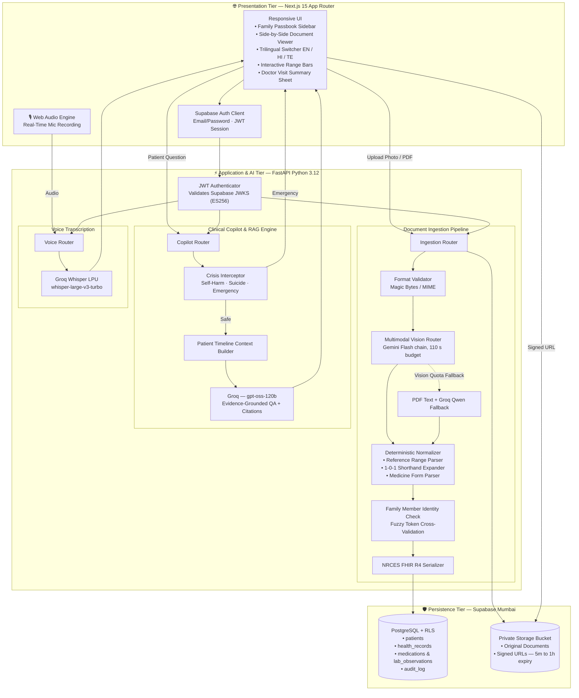

---

## 🚀 Deployment Architecture

The production stack is configured for **enterprise resilience** across cloud providers:

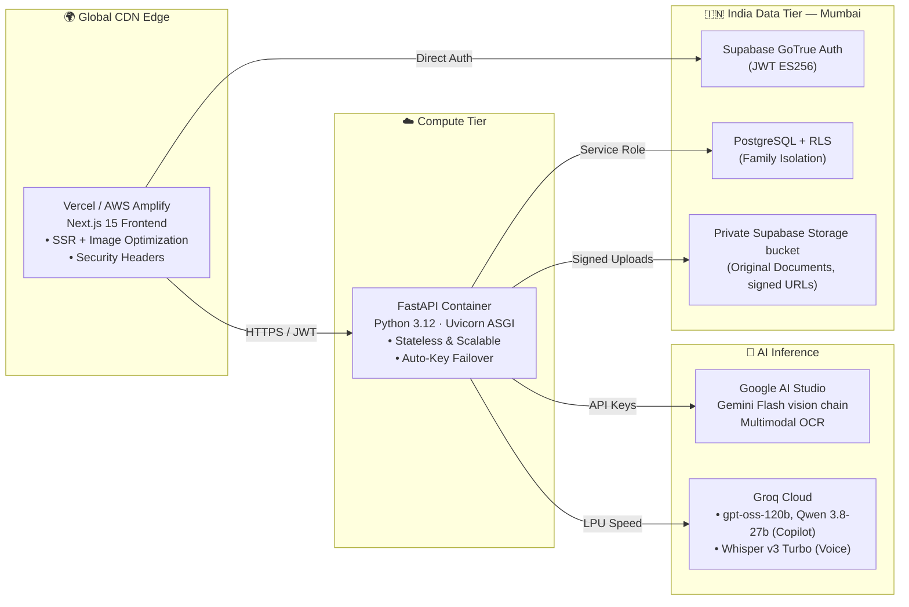

| Layer | Platform | Region | Key Capabilities |
|---|---|---|---|
| **Frontend** | Vercel / AWS Amplify | Global Edge | Next.js 15 App Router, responsive mobile-first UI, Trilingual |
| **Backend API** | Render / AWS App Runner | Singapore / Mumbai | Dockerized FastAPI, multi-key cooldown, rate-limit retry |
| **Database & Auth** | Supabase | `ap-south-1` Mumbai | PostgreSQL + strict RLS, encrypted private buckets |
| **AI Vision** | Google Gemini | Distributed | Multimodal OCR with 4-level model fallback |
| **AI LLM & STT** | Groq LPU | Ultra-Low Latency | `gpt-oss-120b` (fallback `qwen3.8-27b`) for answers, `whisper-large-v3-turbo` for voice |

> 📖 **Full deployment guide**: See [DEPLOYMENT.md](docs/DEPLOYMENT.md) for step-by-step instructions covering Vercel+Render, all-Render, and AWS options.

---

## 🧠 AI Intelligence Layer

The AI system operates as a **sequential pipeline of specialized agents** with deterministic safety rules at every stage. For the complete specification, see [AI_LAYER.md](AI_LAYER.md).

### Pipeline Overview

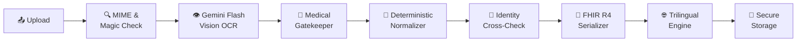

### Model Routing Matrix

| Task | Engines, in the order tried | Measured time |
|---|---|---|
| **Medical vision OCR** | `gemini-3.5-flash` → `gemini-3.7-flash` → `flash-lite` → `gemini-3.8-flash` | ≈ 15 s per document ([results](backend/eval/results.md)) |
| **PDF text fallback** | `pypdf` text layer → Groq `qwen3.8-27b` | not benchmarked |
| **Copilot grounded Q&A** | Groq `gpt-oss-120b` → Groq `qwen3.8-27b` → Gemini | 24/24 checks ([results](backend/eval/copilot_results.md)) |
| **Voice to text** | Groq `whisper-large-v3-turbo` | not benchmarked |
| **Lab trends, FHIR, flags** | Deterministic Python, no model | instant |
| **Emergency screening** | Deterministic regex, before any model | instant |
| **Health-only scope** | Deterministic screen before the model, prompt rule, and an output check that never shows code | instant |

### Key AI Differentiators

- **Zero Hallucinated Normality** — Lab flags are computed from the printed reference range, never guessed by the model
- **Honest Failure** — Illegible or non-medical uploads are rejected with an explanation; nothing fabricated is ever saved
- **Grounded Citations** — Every copilot answer includes `[ab12cd34]` citation tags linking to the exact source document
- **Indian Clinical Shorthand** — Dosage notation like `1-0-1`, `OD`, `BD`, `SOS` is expanded into plain-language instructions

---

## ✨ Core Features

### 1. Side-by-Side Source Verification
Every extracted value is displayed alongside the original image or PDF, so a family member can check each number against the paper it came from.

### 2. Multi-Generational Family Passbook
A single caregiver account manages multiple family profiles (Mother, Father, Self, Child).

> **Name Mismatch Detection**: If a document uploaded to "Lakshmi Devi" contains the printed name "Suresh Yadav", the system flags it immediately:
> *"⚠️ This document names Suresh Yadav, but is filed under Lakshmi Devi."*
> One-click reassignment moves it to the correct profile and regenerates the FHIR bundle.

### 3. ABDM FHIR R4 Compliance
- Maps every document to **NRCES profiles**: `PrescriptionRecord`, `DiagnosticReportRecord`, `DischargeSummaryRecord`
- Supports ABHA number (`91-1234-5678-9012`) and ABHA address (`name@abdm`) validation
- Full **FHIR R4 Bundle Export** and **Bidirectional FHIR Import**

### 4. Interactive Range Visualization
Out-of-range lab markers feature interactive range bars showing where the patient's value sits relative to low, normal, and high bounds.

### 5. Printable Doctor Visit Summary
One-click printable clinical handoff sheet: active medications, out-of-range labs, and suggested questions for the doctor.

### 6. Sub-Second Multilingual Voice Assistant
Speak questions in English, Hindi, or Telugu. Groq Whisper LPU transcribes speech in ~150ms.

### 7. Remote Model Context Protocol (MCP) Server (`/mcp`)
- Hosted on official **Streamable HTTP transport** at `https://mycopilot.qd.je/mcp`.
- Connects directly to **ChatGPT**, **Cursor IDE**, and **Claude Desktop**.
- Exposes 8 specialized clinical tools:
  - `list_patient_profiles`: Lists family members in the account.
  - `get_patient_summary`: Executive medical summary per patient.
  - `get_prescribed_medications`: Active dosages, frequency, and food timings.
  - `get_lab_reports`: Biomarker observations and HIGH/LOW abnormal flags.
  - `check_drug_safety`: Real-time screening for drug-drug interactions and food contraindications.
  - `ask_health_copilot`: Strict grounded answers with source citations.
  - `find_specialist_doctors`: Verified local doctors and hospitals by condition.
  - `get_synthetic_wellness_demo`: Computer-generated vital trends for safe demonstrations.

### 8. In-App Data Governance & Zero-Trust Isolation
- **Personal MCP Access Keys (PAT)**: Cryptographic tokens (`phc_mcp_...`) scoping external AI access strictly to the owner's family records.
- **Emergency Kill-Switch**: One-click master toggle in the web portal to immediately refuse all external AI queries.
- **Granular Tool & Patient Governance**: Selectively disable individual tools (e.g. allow reading lab reports but block reasoning) or hide specific family members.
- **Live Audit Trail**: In-app audit log tracking every tool invoked by external AI agents with timestamps and queried subjects.

### 9. ABHA Milestone 1, 2, 3 (ABDM Health Network)
- **M1**: ABHA Number & ABHA Address generation with Aadhaar/Mobile OTP authentication.
- **M2**: Health Information Provider (HIP) linking and automatic discovery of clinical records across hospitals.
- **M3**: Consent management framework and secure FHIR R4 electronic health record transfers.

### 10. Care-Plan Agent
- Reads each prescription and lab report and sets up **dose reminders**, **follow-up visits** and **repeat tests** on its own, with times taken from the prescription ("empty stomach", "after lunch") and an end date from the course length.
- **Overdue** visits and tests are flagged with the doctor's own words; questions for the next visit are drafted.
- Deterministic and idempotent: run it twice and you get the same plan; anything the family removed stays removed. The family keeps, edits or removes every item.
- **Add to phone calendar** (.ics) so the phone rings at each dose time even when the app is closed.

### 11. Isolated Sandbox Demo Mode (`DEMO_MODE=true`)
- Unauthenticated sandbox for fast demonstration and evaluation inside ChatGPT and MCP clients.
- Safely isolated to computer-generated synthetic data with zero exposure of real patient PHI, credentials, or destructive database writes.

---

## 🗄 Data Model & Security

All database operations are governed by **PostgreSQL Row-Level Security (RLS)**.

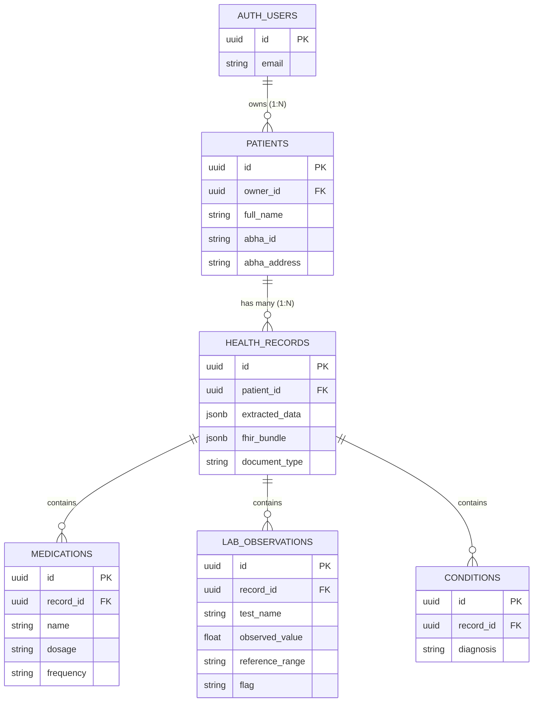

**Security guarantees:**
- **Identity Isolation**: Every row has an `owner_id`. Users can never query records belonging to another caregiver.
- **Private Storage**: Original documents stored under `<owner_id>/<record_id>` in private Supabase Storage buckets.
- **Short-Lived Signed URLs**: Pre-signed URLs expire after 1 hour; previews are cached for instant navigation.
- **Audit Logging**: Every document view, upload, delete, and export is recorded in `audit_log`.

---

## 💻 Local Setup

### Prerequisites

| Requirement | Version |
|---|---|
| Python | 3.12+ |
| Node.js | 18+ |
| Google AI Studio Key | [Get one free](https://aistudio.google.com/) |
| Groq API Key | [Get one free](https://console.groq.com/) |
| Supabase Project | [Create free](https://supabase.com) |

### 1. Backend

```bash
cd backend
python -m venv venv

# Windows
.\venv\Scripts\activate
# Linux / macOS
source venv/bin/activate

pip install -r requirements.txt
cp .env.example .env
```

Configure `backend/.env`:

```env
PROJECT_NAME="AI-Powered Personal Health Copilot"
API_V1_PREFIX="/api/v1"

# AI Inference Keys
GEMINI_API_KEY="AIzaSy..."
GEMINI_API_KEY_FALLBACK="AIzaSy..."       # Optional: secondary key for auto-failover
GROQ_API_KEY="gsk_..."

# Supabase Configuration
SUPABASE_URL="https://<your-project>.supabase.co"
SUPABASE_KEY="sb_secret_..."
SUPABASE_PUBLISHABLE_KEY="sb_publishable_..."
SUPABASE_JWKS_URL="https://<your-project>.supabase.co/auth/v1/.well-known/jwks.json"
FRONTEND_ORIGIN="http://localhost:3000,http://localhost:3010"
```

Start the backend:

```bash
uvicorn app.main:app --reload --port 8000
```

Verify: open `http://localhost:8000/health` — should return `{"status":"ok","vision":true,"language_model":true}`.

### 2. Frontend

```bash
cd frontend
npm install
cp .env.example .env.local
```

Configure `frontend/.env.local`:

```env
NEXT_PUBLIC_BACKEND_URL="http://localhost:8000/api/v1"
NEXT_PUBLIC_SUPABASE_URL="https://<your-project>.supabase.co"
NEXT_PUBLIC_SUPABASE_PUBLISHABLE_KEY="sb_publishable_..."
```

Run the development server:

```bash
npm run dev
```

Open `http://localhost:3000` in your browser.

---

## 🎬 Live Demo Script

> **Duration**: 5 minutes · **Audience**: Reviewers & Clinicians

| Step | Action | What to Highlight |
|---|---|---|
| **1. Sign In** | Press **Use the demo family** → Sign in → **Load sample**. Select **Lakshmi Devi** (44). | "Haemoglobin is low" first; trends show haemoglobin improving, thyroid and vitamin D back in range. |
| **2. Source check** | Timeline → the 14 Aug lab report → hover **Haemoglobin**. | The value lights up where it is printed on the original page. Flags come from the printed range, not the model. |
| **3. Care plan** | **Care plan** tab. | The copilot set up the reminders from the prescription; keep, edit or remove each one. |
| **4. Overdue** | Select **Venkata Rao K.** → Care plan. | Follow-up and FBS/HbA1c **overdue since 17 Aug 2026**, quoting the doctor; questions for the next visit drafted. |
| **5. Language & voice** | Switch to **తెలుగు** → Ask → mic → ask about tonight's medicines. | Answer in Telugu, read aloud, with the source reports cited. |
| **6. Health only** | In Ask, type *"give me a python code for fibonacci series"*. | Declined in one line; no model is called. |
| **7. Non-medical rejection** | Upload `live-demo_not_a_medical_document.png`. | Gatekeeper rejects with an honest reason. Nothing saved. |
| **8. Phone calendar** | Care plan → **Add to phone calendar**. | .ics with alarms at each dose time until the course ends. |
| **9. Visit summary & FHIR** | **Visit summary**, then **Export ABDM record**. | One-page handoff sheet; FHIR R4 bundle in the NRCES profiles. |

---|---|---|
| **1. Sign In** | Log in with the demo caregiver account. Select **Lakshmi Devi** (Elderly Mother, 64 yrs). | Family passbook sidebar, health timeline, 3 abnormal lab markers with range bars. |
| **2. Language Switch** | Switch the UI from **English** → **తెలుగు (Telugu)** or **हिन्दी (Hindi)**. | All clinical summaries, dosage instructions, and explanations adapt in real-time. |
| **3. Document Inspection** | Open Lakshmi's **Lipid Profile Lab Report**. | Side-by-side: original on left, extracted data on right. `Serum Cholesterol 240 mg/dL (Range: 125-200)` flagged HIGH by math, not AI guesswork. |
| **4. Copilot Chat** | Ask: *"What medicines does Lakshmi take for her thyroid and when?"* | Calm plain-language answer with clickable citation tag `[ab12cd34]` pointing to the prescription. |
| **5. Voice Input** | Tap the mic icon and speak in Hindi or Telugu. | Groq Whisper transcribes in ~150ms and routes to the Copilot. |
| **6. Name Mismatch** | Upload `live-demo_suresh_yadav_hindi_prescription.png` into Lakshmi's passbook. | System identifies "Suresh Yadav", flags mismatch, prompts one-click move. |
| **7. Non-Medical Rejection** | Upload `live-demo_not_a_medical_document.png`. | Gatekeeper rejects with honest reason. Nothing saved to database. |
| **8. FHIR Export/Import** | Link mock ABHA ID `91-1234-5678-9012`. Export FHIR R4 Bundle JSON. Import it into another profile. | Round-trip ABDM interoperability. |
| **9. Visit Summary** | Click **Print Visit Summary**. | Clean one-page clinical handoff sheet for the doctor. |

---

## 🛡 Clinical Safety

Health Copilot enforces **six distinct layers** of clinical safety — most executing before any AI model is called:

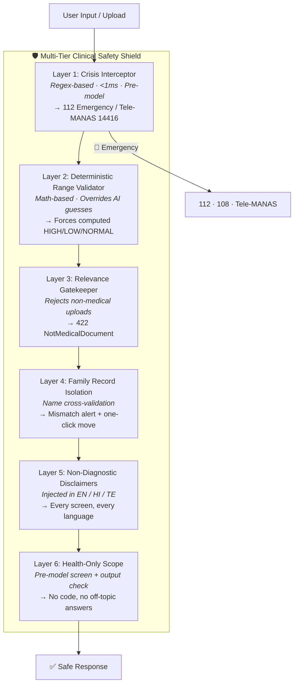

| Layer | Mechanism | Guarantee |
|---|---|---|
| **Crisis Interceptor** | Compiled regex in English, Hindi (Devanagari), and Telugu | Runs before any model and works even if AI services are offline; covered by `tests/test_guardrails.py` |
| **Range Validator** | Parses printed reference ranges, computes flags mathematically | AI's opinion is never trusted for lab normality |
| **Relevance Gatekeeper** | Rejects non-medical images with honest explanation | Zero fabricated records from landscapes, invoices, menus |
| **Record Isolation** | Tokenized name cross-check against profile | Prevents dangerous family record cross-contamination |
| **Non-Diagnostic Policy** | Mandatory disclaimers rendered on every screen | Never diagnoses, never advises changing dosages |
| **Health-Only Scope** | Rule-based screen for code requests before the model, a scope rule in the prompt, and an output check that replaces any answer containing code | The copilot is not a free general chatbot, in the app, over MCP or in ChatGPT Actions; covered by `tests/test_guardrails.py` and the copilot eval |

---

## 📊 Clinical Architecture & Feature Capabilities

How each clinical need is met, and where to see it working on the sample family (sign in with the demo account, press **Load sample**).

| Brief | What the product does | Where to see it |
|---|---|---|
| **3.1 Conversational assistant** | Answers from the person's own records and care plan, cites the record behind each fact, says "not in the records" instead of guessing, never changes doses, sends emergencies to 112 / 108 / Tele-MANAS. English, Hindi, Telugu, by text or voice. | **Ask** tab. Try "Is any test overdue for him?" on Venkata Rao. |
| **3.2 Medication & appointment reminders** | Reminders built from each prescription: name, dose, times from 1-0-1 notation and timing notes, end date from the duration, so they stop when the course ends. Follow-up visits from the doctor's own words. Taken / snooze / skip, edit, remove, add your own visit or test. Phone-calendar export (real alarms with the app closed) and in-app reminders. | **Care plan** tab |
| **3.3 Wellness guidance** | Diet and lifestyle guidance from the person's conditions and values, with the reason for each suggestion and clear limits (not a diet prescription; cautions for diabetes medicines and blood thinners). | **Overview → diet guide** |
| **3.4 Risk insights & preventive steps** | Lab trends across reports judged against the printed range; values that stay out of range; repeat tests the doctor asked for, closed automatically when a later report has them; condition-based checks (HbA1c with diabetes medicines, yearly kidney test, lipid profile on a statin). Worded as things to discuss with the doctor. | **Overview → How results are changing**, **Care plan → Visits and tests** |
| **Bonus: agentic AI** | After every upload the agent schedules reminders, flags overdue follow-ups, proposes repeat tests and drafts questions for the next visit. Everything it did is listed for the family to keep, edit or remove; removed items never come back. | Upload a prescription → **Review reminders** |
| **Bonus: voice** | Speak a question in English, Hindi or Telugu; hear the answer read back. | **Ask → mic** |
| **Bonus: family management** | One account, many people, each with records, reminders, trends and an emergency card. Reminders for the whole family arrive in one place. | Family row at the top |
| **Bonus: languages, extended** | The chosen language carries through chat, voice, reminders and the calendar export. | Language switch, top bar |

**Trust features.** Every value on a record can be highlighted on the original page (hover or "Show on the page"). Flags are computed from the printed range, not taken from the model. The care plan, trends and FHIR export are deterministic code, so every reminder traces back to a line on a document.

**Evidence** (regenerate with the commands shown):

| Check | Result | Command |
|---|---|---|
| Extraction accuracy, 10 sample documents incl. blurred phone photos and a refused grocery list | 107 / 107 facts | `cd backend && python -m eval.run_eval` → [results](backend/eval/results.md) |
| Copilot: grounding, honesty about gaps, safety, Hindi / Telugu, care-plan awareness | 20 / 20 checks | `cd backend && python -m eval.copilot_eval` → [results](backend/eval/copilot_results.md) |
| Backend tests (care plan, trends, flags, FHIR, guardrails, auth on every route, rate limits, MCP access) | 153 passing | `cd backend && python -m pytest -q tests` |

| Evaluation Dimension | How Personal Health Copilot Delivers |
|---|---|
| **Problem understanding** | One passbook per family member; the name on every document is checked against the person it is filed under; explanations in English, Hindi and Telugu. |
| **Solution quality** | Upload → plain-language summary → abnormal values → medicine schedule → timeline → lab trends across reports → grounded Q&A with citations → visit summary → FHIR export |
| **Technical execution** | Deterministic flags, trends and FHIR around the models; 79 backend tests in CI (`backend/tests`, `.github/workflows/ci.yml`) |
| **Innovation** | Lab trends judged against each report's printed range, fed back into the copilot so it can answer "is it improving?" with citations |
| **User experience** | Trilingual UI, voice questions, read-aloud answers, side-by-side original document, printable visit summary |
| **Data / AI intelligence** | 107/107 facts on the sample set, regenerable with `python -m eval.run_eval` ([results](backend/eval/results.md)); model output is checked, never trusted for flags |
| **Deployment & scalability** | Live at mycopilot.qd.je (EC2 Mumbai + Caddy, Amplify); per-user rate limits, locked CORS, Dockerfile, 110 s extraction budget; [docs/DEPLOYMENT.md](docs/DEPLOYMENT.md) |
| **Impact** | Families who juggle paper records across clinics, in their own language, with ABDM-ready FHIR export |

---

## 📚 Documentation

All supplementary and in-depth guides are neatly organized inside the [`docs/`](docs/) directory:

| Document | Description |
|---|---|
| [docs/AI_LAYER.md](docs/AI_LAYER.md) | Deep-dive into AI pipeline architecture, prompt templates, safety guardrails, and benchmark results |
| [docs/MCP_SETUP_GUIDE.md](docs/MCP_SETUP_GUIDE.md) | Enterprise Model Context Protocol guide for ChatGPT, Cursor IDE, Claude Desktop, and In-App Data Governance |
| [docs/CHATGPT_SETUP_GUIDE.md](docs/CHATGPT_SETUP_GUIDE.md) | Step-by-step guide to connect ChatGPT via Remote MCP Streamable HTTP or Custom GPT Actions |
| [docs/PRODUCT.md](docs/PRODUCT.md) | Product vision, target users, and clinical design philosophy |
| [docs/DEPLOYMENT.md](docs/DEPLOYMENT.md) | Step-by-step production deployment guide for AWS EC2, Caddy reverse proxy, and Docker |

---

<div align="center">

**Personal Health Copilot · Intelligent Family Health Passbook & Clinical Platform**

*Special Thanks: NRCES India · Groq · Google DeepMind*

</div>
